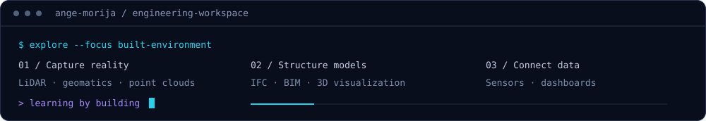

  

  
  

<h1 align="center">Hi, I'm Ange-Morija 👋</h1>

<b>Civil engineering &amp; geomatics background · Building digital tools for the built environment</b>

  

  <a href="#about-me">About</a> · <a href="#featured-projects">Projects</a> · <a href="#personal-initiatives">Initiatives</a> · <a href="#toolbox">Toolbox</a> · <a href="#currently-exploring">Learning</a> · <a href="#github-activity">Activity</a> · <a href="#lets-connect">Contact</a>

## About me

I'm **Ange-Morija KOUAMENAN**, an engineer with a background in **civil engineering and geomatics**, building connections between the physical world, digital models and operational data.

My path brings together **surveying and project delivery**, **BIM and digital twins**, and **tunnel lighting control and commissioning**. I want to make engineering information useful throughout an asset's life — from field capture to operation and maintenance.

- 🎓 **Education:** École des Ponts ParisTech and ESTP Paris, with an international academic background including BME and UPM.
- 🏗️ **Surveying & project delivery:** experience at QUARTA, with field surveys, spatial data and technical deliverables.
- 💡 **Tunnel systems:** project experience at Comatelec Schréder involving ATS/TLA, Lumgates, sensors, bus diagnostics, lighting scenes and commissioning.
- 🏢 **Professional direction:** building operation and maintenance, technical performance and digital tools for asset management.
- 🧩 **Builder mindset:** Python tools, IFC workflows, point cloud analysis, web interfaces and monitoring prototypes.
- 🌍 **Based in France**, with a strong interest in practical technology for African contexts.

> My focus: connect field knowledge, engineering methods and software to solve practical problems.

### Engineering interests

| Domain | What interests me |
| :--- | :--- |
| Reality capture & geomatics | Field surveys, LiDAR, point cloud measurements and quality control |
| BIM & digital twins | IFC interoperability, 3D visualization and operational information |
| Tunnel lighting & control | Sensors, lighting scenes, bus communication and commissioning |
| Building operation & maintenance | Technical audits, performance monitoring and maintenance workflows |
| Software & applied AI | Engineering automation, reusable tools and assistants grounded in technical documents |

## Featured projects

<table>
<tr>
<td width="50%" valign="top">
<h3>🏢 BIM Viewer</h3>

Explore building models in a browser with Autodesk Platform Services, custom viewer extensions and access to model information.

 

<a href="https://github.com/Ange-Morija/3d_model_viewer"><b>Explore the repository →</b></a>
</td>
<td width="50%" valign="top">
<h3>📐 bimpy</h3>

Python CLI tools to inspect IFC files, extract properties, export spatial trees, process batches and merge models.

 

<a href="https://github.com/Ange-Morija/bimpy"><b>Explore the repository →</b></a>
</td>
</tr>
<tr>
<td width="50%" valign="top">
<h3>🚘 LiDAR Vehicle Profiles</h3>

Process LiDAR scans into 3D point clouds and measure vehicle dimensions in a simulated highway detection workflow.

 

<a href="https://github.com/Ange-Morija/Profile_sanner"><b>Explore the repository →</b></a>
</td>
<td width="50%" valign="top">
<h3>🌡️ Temperature &amp; Humidity Monitoring</h3>

An ESP32 sensor prototype connecting temperature and humidity measurements to InfluxDB and a Flask/Grafana dashboard.

 

<a href="https://github.com/Ange-Morija/Temp_Humidity_Monitoring"><b>Explore the repository →</b></a>
</td>
</tr>
</table>

<a href="https://github.com/Ange-Morija?tab=repositories"><b>View all public repositories →</b></a>

## Personal initiatives

Alongside my professional work, I develop independent projects at different stages of exploration and prototyping.

<table>
<tr>
<td width="50%" valign="top">
<h3>🌐 Geodemy</h3>

My entrepreneurial initiative around geomatics, reality capture, Scan-to-BIM and technical training. My software work explores point cloud analysis tools and reusable interfaces for engineering applications.

</td>
<td width="50%" valign="top">
<h3>🎓 Môya</h3>

An educational device concept for African learners, exploring offline assistance through local AI. Current interests include embedded hardware, accessible product design and learning without a permanent internet connection.

</td>
</tr>
<tr>
<td width="50%" valign="top">
<h3>🌿 Environmental monitoring</h3>

A pilot concept for Yamoussoukro combining environmental indicators, field sensors and dashboards. I also explore indoor air quality monitoring and practical ways to turn measurements into decisions.

</td>
<td width="50%" valign="top">
<h3>📚 Éclairer la ville intelligente</h3>

A personal technical book project in two volumes: public lighting design and connected lighting systems for smart cities. The aim is to connect engineering principles, workflows and documented sources.

</td>
</tr>
</table>

These are personal initiatives; descriptions indicate intended scope, not released products or employer-backed projects.

## Toolbox

Tools I use across projects and experiments.

**Code & web**

**Data, monitoring & deployment**

**Engineering & spatial workflows**

| Area | Tools & formats |
| :--- | :--- |
| BIM & infrastructure | Revit · AutoCAD · Navisworks · InfraWorks · IFC |
| Point clouds & reality capture | CloudCompare · Register360 · Metashape · LiDAR |
| Geospatial analysis | QGIS · ArcGIS · PostGIS |
| Connected prototypes | ESP32 · MicroPython · sensor data · dashboards |
| Cloud platforms | AWS · Azure |

## Currently exploring

- 🧠 Applied AI, retrieval-augmented generation and assistants for technical workflows.
- 🏙️ Digital twins for building and infrastructure operation.
- 💡 Lighting control, photometry and connected urban systems.
- ⚙️ Reusable web components and automation for engineering projects.
- 🔌 Embedded development with ESP32 and Raspberry Pi, plus local infrastructure experiments.
- 📊 Performance indicators and dashboards for building operation and maintenance.

<b>🇫🇷 En quelques mots</b>

Ingénieur de formation en **génie civil et géomatique**, mon parcours relie les relevés de terrain et la conduite de projets chez **QUARTA**, les **jumeaux numériques et le BIM**, puis les **systèmes de commande d'éclairage de tunnels chez Comatelec Schréder** : ATS/TLA, Lumgates, capteurs, diagnostics bus et mise en service.

Je souhaite rapprocher ces compétences des enjeux de **performance technique, d'exploitation et de maintenance des bâtiments et infrastructures**.

En parallèle, je développe mes initiatives personnelles : **Geodemy**, des outils pour les nuages de points et l'IFC, le concept éducatif **Môya**, des expérimentations de suivi environnemental et un projet de livre technique intitulé **Éclairer la ville intelligente**.

Ce profil présente mes réalisations publiques, mes prototypes et mes sujets d'apprentissage. Mes projets personnels sont indépendants de mes employeurs.

## GitHub activity

  
  

Statistics cards are provided by an external service and may be temporarily unavailable. Language distribution reflects repository contents.

## Let's connect

Interested in **BIM, geomatics, digital twins or infrastructure tools**? Let's exchange ideas and build useful things.

  
  

<b>Measure reality. Structure information. Build useful tools.</b> Thanks for visiting — explore a project, open an issue or contribute an improvement.

