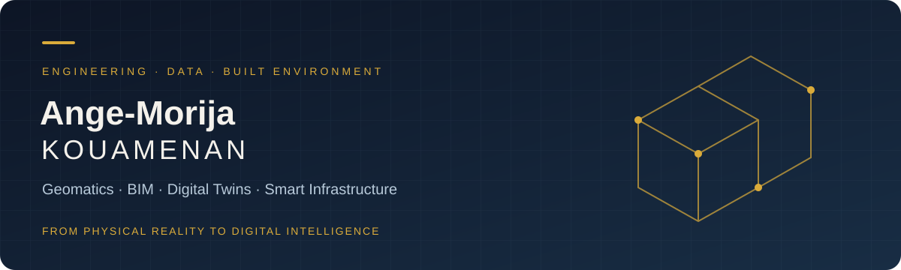

  

  
  

<h1 align="center">Hi, I'm Ange-Morija 👋</h1>

<b>Civil engineering &amp; geomatics background · Building digital tools for the built environment</b>

  

  <a href="#about-me">About</a> · <a href="#featured-projects">Projects</a> · <a href="#toolbox">Toolbox</a> · <a href="#currently-exploring">Learning</a> · <a href="#github-activity">Activity</a> · <a href="#lets-connect">Contact</a>

---

## About me

I work at the intersection of **geomatics, BIM, digital twins and infrastructure**. I enjoy connecting field measurements, 3D models and software to make technical information easier to explore and use.

- 🏗️ **Engineering background:** civil engineering and geomatics, with studies at École des Ponts ParisTech and ESTP Paris.
- 🌍 **Experience:** surveying and project delivery, alongside tunnel lighting control systems, sensors and commissioning.
- 🧩 **What I build:** tools for point cloud processing, IFC data exploration, 3D visualization and monitoring dashboards.
- 🎯 **Direction:** bring digital twins and data into the operation and maintenance of buildings and infrastructure.
- 📍 **Based in France** · French & English.

> From physical reality to digital intelligence — one useful tool at a time.

## Featured projects

<table>
<tr>
<td width="50%" valign="top">
<h3>🏢 BIM Viewer</h3>

Explore building models in a browser with Autodesk Platform Services, custom viewer extensions and access to model information.

 

<a href="https://github.com/Ange-Morija/3d_model_viewer"><b>Explore the repository →</b></a>
</td>
<td width="50%" valign="top">
<h3>📐 bimpy</h3>

Python CLI tools to inspect IFC files, extract properties, export spatial trees, process batches and merge models.

 

<a href="https://github.com/Ange-Morija/bimpy"><b>Explore the repository →</b></a>
</td>
</tr>
<tr>
<td width="50%" valign="top">
<h3>🚘 LiDAR Vehicle Profiles</h3>

Process LiDAR scans into 3D point clouds and measure vehicle dimensions in a simulated highway detection workflow.

 

<a href="https://github.com/Ange-Morija/Profile_sanner"><b>Explore the repository →</b></a>
</td>
<td width="50%" valign="top">
<h3>🌡️ Temperature &amp; Humidity Monitoring</h3>

An ESP32 sensor prototype connecting temperature and humidity measurements to InfluxDB and a Flask/Grafana dashboard.

 

<a href="https://github.com/Ange-Morija/Temp_Humidity_Monitoring"><b>Explore the repository →</b></a>
</td>
</tr>
</table>

<a href="https://github.com/Ange-Morija?tab=repositories"><b>View all public repositories →</b></a>

## Toolbox

Tools I use across projects and experiments.

**Code & web**

**Data, monitoring & deployment**

**Engineering & spatial workflows**

| Area | Tools & formats |
| :--- | :--- |
| BIM & infrastructure | Revit · AutoCAD · Navisworks · InfraWorks · IFC |
| Point clouds & reality capture | CloudCompare · Register360 · Metashape · LiDAR |
| Geospatial analysis | QGIS · ArcGIS · PostGIS |
| Connected prototypes | ESP32 · MicroPython · sensor data · dashboards |
| Cloud platforms | AWS · Azure |

## Currently exploring

- 🧠 Applied AI, retrieval-augmented generation and assistants for technical workflows.
- 🏙️ Digital twins for building and infrastructure operation.
- 💡 Lighting control, photometry and connected urban systems.
- ⚙️ Reusable web components and automation for engineering projects.

<b>🇫🇷 En quelques mots</b>

Ingénieur de formation en génie civil et géomatique, je développe des outils à la croisée du **BIM, des nuages de points, des jumeaux numériques et des infrastructures intelligentes**.

Mon parcours associe relevés et conduite de projets, puis systèmes de commande d'éclairage de tunnels, capteurs et mise en service. Je m'intéresse particulièrement à l'utilisation des données pour améliorer l'exploitation et la maintenance des bâtiments et infrastructures.

Sur ce profil, je partage mes projets, mes expérimentations et ma progression technique.

## GitHub activity

  
  

Statistics cards are provided by an external service and may be temporarily unavailable. Language distribution reflects repository contents.

## Let's connect

Interested in **BIM, geomatics, digital twins or infrastructure tools**? Let's exchange ideas and build useful things.

  
  

---

<b>Measure reality. Structure information. Build useful tools.</b> Thanks for visiting — explore a project, open an issue or contribute an improvement.

