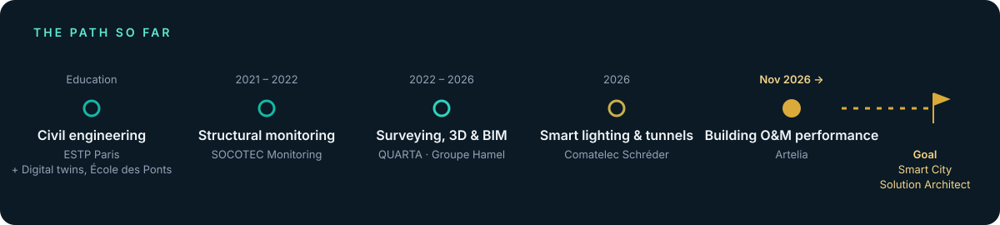
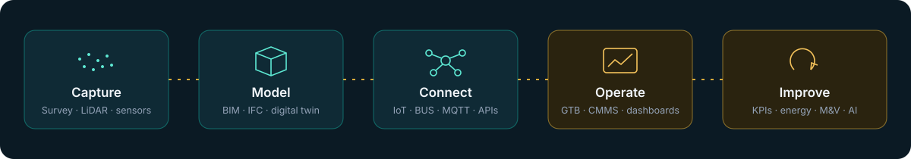

  

  
  
  
  

  <a href="#-about">About</a> ·
  <a href="#-what-i-do">What I do</a> ·
  <a href="#-projects">Projects</a> ·
  <a href="#-independent-initiatives">Initiatives</a> ·
  <a href="#-home-lab">Lab</a> ·
  <a href="#-toolbox">Toolbox</a> ·
  <a href="#-now-learning">Learning</a> ·
  <a href="#-en-français">Français</a>

## 👋 About

I'm **Ange-Morija**, a civil engineer turned **geomatics, smart‑infrastructure and building‑operations** engineer. I like the moment when a measurement taken in the field becomes a model, then a data stream, then a decision someone can act on.

- 🏢 **Now** — joining **Artelia** (Nov 2026) as an *Operations & Maintenance Performance and Intelligence Engineer* for buildings: technical audits, maintenance contracts, performance monitoring in operation.
- 💡 **Before** — Smart City project manager for **road tunnels at Comatelec Schréder**: ATS/TLA lighting control, Lumgate BUS networks, luminance meters, lighting scenes and commissioning.
- 📐 **Roots** — surveying engineer and business manager at **QUARTA**, structural monitoring at **SOCOTEC Monitoring**: total station, GNSS, laser scanning, point clouds, 2D plans and BIM models.
- 🎓 **Education** — civil engineering at **ESTP Paris**, digital twins at **École des Ponts ParisTech**.
- 🌍 **Based in France**, Ivorian, with a strong focus on practical technology for **Côte d'Ivoire and West Africa**.
- 🎯 **Next** — growing into a **Smart City Solution Architect**.

## 🧭 What I do

| Domain | In practice |
| :--- | :--- |
| **Reality capture & geomatics** | Total station, GNSS, LiDAR / 3D scanning, photogrammetry, point cloud QA, scan‑to‑BIM |
| **BIM & digital twins** | Revit, IFC interoperability, model checking, linking models with live sensor data |
| **Tunnel & smart lighting** | ATS/TLA programming, BUS scans, L20 luminance meters, threshold settings, inrush‑current measurement, commissioning |
| **Building operations & maintenance** | Technical audits, tender documents, multi‑technical contracts, GTB/BMS, CMMS, KPIs and energy performance |
| **Software & applied AI** | Python/JS tooling, dashboards, automation of engineering studies, LLM extraction from technical documents |

## 🛠 Projects

<table>
<tr>
<td width="50%" valign="top">
<h3>📐 bimpy</h3>

Python CLI to inspect IFC files, extract properties, export spatial trees, batch‑process and merge models.

 

<a href="https://github.com/Ange-Morija/bimpy"><b>Repository →</b></a>
</td>
<td width="50%" valign="top">
<h3>🏢 BIM Viewer</h3>

Browser‑based building model viewer on Autodesk Platform Services, with custom extensions and model data access.

 

<a href="https://github.com/Ange-Morija/3d_model_viewer"><b>Repository →</b></a>
</td>
</tr>
<tr>
<td width="50%" valign="top">
<h3>🚘 LiDAR Vehicle Profiles</h3>

Turns LiDAR scans into 3D point clouds and measures vehicle dimensions in a simulated highway detection workflow.

 

<a href="https://github.com/Ange-Morija/Profile_sanner"><b>Repository →</b></a>
</td>
<td width="50%" valign="top">
<h3>🌡️ Temperature & Humidity Monitoring</h3>

ESP32 sensor node streaming to InfluxDB, visualised through a Flask / Grafana dashboard.

  

<a href="https://github.com/Ange-Morija/Temp_Humidity_Monitoring"><b>Repository →</b></a>
</td>
</tr>
<tr>
<td width="50%" valign="top">
<h3>☁️ Point Cloud Analysis Toolkit <code>in progress</code></h3>

Web tool for surveyors and BIM engineers: import LAS/LAZ/E57/PLY, clean, segment, measure, cut sections, compare scans and export to IFC or CSV.

 

</td>
<td width="50%" valign="top">
<h3>🎓 Môya — website</h3>

Landing site for Môya, a pocket learning assistant concept (see below).

 

<a href="https://github.com/Ange-Morija/moya"><b>Repository →</b></a>
</td>
</tr>
</table>

<a href="https://github.com/Ange-Morija?tab=repositories"><b>All public repositories →</b></a>

## 🚀 Independent initiatives

| | Initiative | What it is | Stage |
| :-: | :--- | :--- | :--- |
| 🌐 | **Geodemy** | My engineering studio: point cloud processing, plans, scan‑to‑BIM, flatness control, BIM/IFC and training — delivered remotely | Active |
| 🎓 | **Môya** | Offline, on‑device AI learning assistant for secondary‑school students in Africa — helps learners *reason*, not copy | Prototyping |
| 🌿 | **Mon Pays Vert** | Environmental observatory pilot in Yamoussoukro: NDVI, water stress, LoRaWAN field sensors and a public dashboard | Concept / pilot |
| 📚 | **Éclairer la ville intelligente** | Two‑volume technical book for engineers on public lighting and running a city through light | Writing |
| 🏙️ | **#SmartCity series** | Editorial series on African smart cities, co‑written with peers | Ongoing |

Personal projects, independent from my employers. "Stage" reflects intended scope, not released products.

## 🧪 Home lab

Where I test things before they reach a project.

- **Lighting & IoT test bench** — DALI / D4i, Zhaga, NEMA, KNX, Modbus, Zigbee, LoRa and MQTT on Raspberry Pi Pico, ESP32 and Arduino.
- **Self‑hosted server** — HP tower on Ubuntu with Nextcloud AIO, plus a Raspberry Pi NAS with its own file dashboard.
- **Indoor air quality** — CO₂, TVOC and particulate sensing with ventilation alerts.

## 🧰 Toolbox

**Code & web**

**Data, IoT & infrastructure**

**Engineering & spatial**

| Area | Tools & formats |
| :--- | :--- |
| BIM & CAD | Revit · AutoCAD + AutoLISP · Covadis · Navisworks · InfraWorks · IFC |
| Reality capture | CloudCompare · Register360 · Metashape · Faro scans · LAS/LAZ/E57 |
| GIS | QGIS · ArcGIS · PostGIS · Web GIS |
| Lighting & control | ATS/TLA · Lumgate BUS · L20 luminance meters · DALI / D4i |
| Cloud | AWS · Azure |

## 📈 Now learning

- 🏢 **Building performance** — GTB/BMS integration, BACS decree, OPERAT / *Décret tertiaire*, IPMVP measurement & verification, OpenDSM.
- 🤖 **Applied AI** — RAG, agents (LangGraph, MCP), evaluation; LLM extraction of tender documents with human validation.
- 🧊 **3D & spatial AI** — point cloud segmentation and 3D deep learning.
- 🌆 **Digital twins** for building and city operations, with a West‑African lens.

## 📊 GitHub activity

  
  

Cards served by an external service; they may occasionally fail to load.

## 🇫🇷 En français

<b>Le parcours en quelques lignes</b>

 

Ingénieur **génie civil (ESTP Paris)**, formé aux **jumeaux numériques (École des Ponts)**, j'ai d'abord travaillé sur le terrain : **monitoring d'ouvrages chez SOCOTEC Monitoring**, puis **géomètre et chargé d'affaires chez QUARTA** (relevés, scan 3D, plans 2D, maquettes BIM).

En 2026, j'ai été **chef de projets Smart City – Tunnels chez Comatelec Schréder** : automatismes ATS/TLA, réseaux BUS Lumgate, luminancemètres, scènes d'éclairage et mises en service.

À partir de **novembre 2026**, je rejoins **Artelia** comme **ingénieur Performance & Intelligence d'Exploitation‑Maintenance** des bâtiments (AMO exploitation‑maintenance) : audits techniques, DCE/CCTP, marchés multitechniques, GTB, GMAO et suivi de la performance.

En parallèle, je développe **Geodemy** (nuages de points, scan‑to‑BIM, IFC, formation), le projet éducatif **Môya**, l'observatoire environnemental **Mon Pays Vert** à Yamoussoukro et le livre **Éclairer la ville intelligente**.

**Objectif : devenir Smart City Solution Architect** — avec la Côte d'Ivoire et l'Afrique de l'Ouest en ligne de mire.

  <b>Measure reality · Structure information · Operate better</b> 
  Open to exchanges on BIM, geomatics, smart lighting, digital twins and building operations — find me on <a href="https://www.linkedin.com/in/kouamenan-ange-morija/">LinkedIn</a>.

